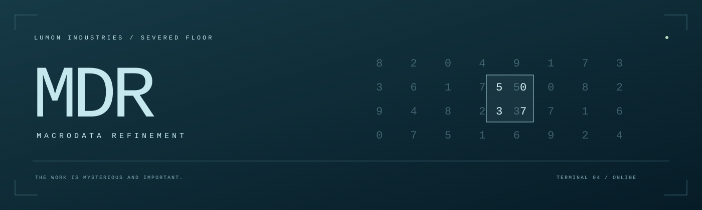
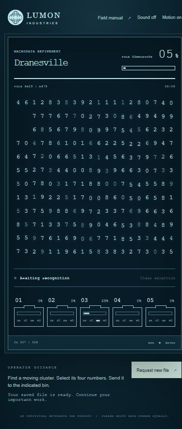
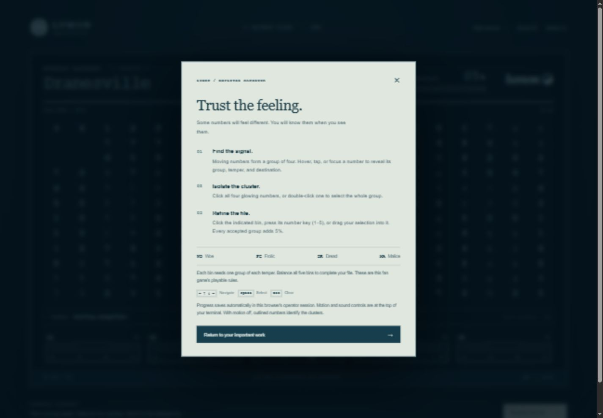

<p align="center"></p>

<p align="center"><a href="https://mdr-refinement-ah2022.ah256.chatgpt.site"><strong>▶ Play online — no installation needed</strong></a></p>


<p align="center">
  <a href="#begin-your-shift"></a>
  
  
  
</p>

<h3 align="center">Find the signal. Trust the feeling. Refine the file.</h3>

<p align="center">An atmospheric, playable recreation inspired by the Macrodata Refinement terminals in <em>Severance</em>.<br>Twenty clusters. Five bins. One very important assignment.</p>

<p align="center"><a href="https://mdr-refinement-ah2022.ah256.chatgpt.site">Play online</a> · <a href="#begin-your-shift">Run locally</a> · <a href="#the-work">How to play</a> · <a href="#terminal-controls">Controls</a> · <a href="#verification">Tests</a></p>

<p align="center"></p>

> **Employee notice** — Please enjoy each number equally.

## Inside your terminal

| The atmosphere | The mechanics |
| --- | --- |
| Deep blue screen, pale phosphor digits, fine scan lines, and a restrained terminal frame | 240 numbers containing 20 distinct groups of four |
| Slowly moving clusters and a signal readout | Five bins, each requiring Woe, Frolic, Dread, and Malice |
| Optional synthesized feedback tones; sound starts off | Server-validated submissions and automatic SQLite saves |
| Responsive layout, keyboard navigation, and a reduced-motion mode | Completion summary, new assignments, and conflict recovery between tabs |

## Begin your shift

You need **Python 3.10+**. No Node.js build, database service, external assets, or API keys are needed to play.

```sh
git clone https://github.com/Ah2022/MDR-Game.git
cd MDR-Game
python -m venv .venv
```

Activate your environment:

| System | Command |
| --- | --- |
| Windows PowerShell | `.venv\Scripts\Activate.ps1` |
| macOS / Linux | `source .venv/bin/activate` |

```sh
python -m pip install -r requirements.txt
python app.py
```

Open **[127.0.0.1:5000](http://127.0.0.1:5000)**. Your assignment is ready.

For a longer-running local server, use the included Waitress dependency:

```sh
waitress-serve --host=127.0.0.1 --port=5000 --call app:create_app
```

Both commands bind to this computer by default. Stop the server with **Ctrl+C**.

## The work

**01 — Recognize.** Look for a moving cluster. Hover, tap, or keyboard-focus a number to illuminate its four-number group and reveal its temper and destination in the signal strip.

**02 — Isolate.** Click each of the four numbers. For quicker selection, double-click one number in a cluster. Selected numbers appear as pale, filled squares.

**03 — Refine.** Click the indicated bin, press its number key, or drag your selected cluster into it. A correct submission adds **5%** to the file and **25%** to that bin. An incorrect submission leaves progress unchanged and records a rejection.

**04 — Balance.** Each bin needs one group of every temper. Refine all twenty groups to reach **100%** and receive your completion notice.

| WO | FC | DR | MA |
| :---: | :---: | :---: | :---: |
| Woe | Frolic | Dread | Malice |

The show leaves parts of refinement mysterious. The visible signal, destination cues, and twenty-group win condition are this fan game's interpretation, designed to make the terminal playable.

<details>
<summary><strong>Open the employee field manual</strong></summary>



</details>

## Terminal controls

| Action | Mouse / touch | Keyboard |
| --- | --- | --- |
| Reveal a signal | Hover or tap a number | Focus the number |
| Move around the number field | Point or tap | Arrow keys; Tab enters/leaves the field |
| Select / deselect a number | Click or tap | Space or Enter |
| Select a complete cluster | Double-click a moving number | Select its four cells individually |
| Submit a selection | Click a bin or drag into it | **1–5** |
| Clear a selection | Clear selection | **Esc** |
| Read the instructions | Field manual | Tab to Field manual, then Enter |
| Request a new assignment | Request new file, then confirm | Tab through the confirmation dialog |

**Sound off/on** enables short, locally generated tones. **Motion on/off** toggles number movement; outlined clusters remain discoverable with motion off. The browser's reduced-motion preference is respected. Your motion setting stays in local storage, while sound always starts off.

## Your work is saved

- Every accepted or rejected submission is committed to **`instance/mdr.sqlite3`**. Reloading the page or restarting the server preserves it.
- An opaque, HttpOnly, SameSite cookie identifies your browser's operator session. Its 30-day lifetime refreshes when the terminal loads. There are no accounts or analytics.
- Another browser, cleared cookies, or a different host (`localhost` versus `127.0.0.1`) starts a separate assignment. Use the same address to resume.
- Submissions use server-owned answers, a CSRF token, and file/revision checks. SQLite transactions prevent two tabs from incrementing the same progress twice.
- A lost response triggers a state refresh rather than automatically replaying a submission. An offline terminal offers **Reconnect**.
- **Request new file** replaces the current assignment after confirmation. There is no archive of previous assignments.

Back up the `instance/` directory if the saved work matters. Stop the server before copying it. Browser cookies are needed to associate those records with an operator. Records remain on disk until the database is removed; browser cookie expiry does not delete them.

### Configuration

| Environment variable | Default | Purpose |
| --- | --- | --- |
| `MDR_DATABASE` | `instance/mdr.sqlite3` | Use an absolute path to place the database on persistent storage |
| `MDR_COOKIE_SECURE` | Off | Set to `1` over HTTPS so the operator cookie is HTTPS-only |

Use a persistent local disk for SQLite. If hosting behind a proxy, configure TLS and the externally visible scheme/host consistently so origin checks work. The public hosted edition runs on Sites with Cloudflare Workers and D1. This repository contains the local Flask edition; hosted and local operator sessions are separate.

## Project map

```text
MDR-Game/
├── app.py                    # Flask app factory, puzzle rules, SQLite persistence
├── requirements.txt          # Flask + Waitress
├── templates/index.html      # Accessible terminal, dialogs, and field manual
├── static/
│   ├── game.js               # Selection, keyboard controls, audio, API recovery
│   ├── style.css             # Responsive terminal and motion preferences
│   └── mark.svg              # Original globe illustration
├── tests/test_game.py        # Rules, isolation, persistence, concurrency
├── docs/images/              # README banner and real game screenshots
└── .github/workflows/tests.yml
```

The original extensionless HTML and Python prototypes have been replaced by the runnable application above.

## Verification

```sh
python -m unittest discover -s tests -v
```

The 15 tests cover valid/invalid groups, incorrect bins, duplicates, malformed payloads, forged answers, CSRF and origin checks, cookie flags, isolated operators, saved progress across app restarts, concurrent requests, reset conflicts, and completion. They use temporary databases and never touch your saved assignment.

If Node.js is available, also check JavaScript syntax:

```sh
node --check static/game.js
```

GitHub Actions runs both checks on pushes and pull requests. Browser interaction and visual checks are separate from the automated backend tests.

## Behind the terminal

This is an **unofficial fan project** inspired by [*Severance* on Apple TV](https://tv.apple.com/us/show/severance/umc.cmc.1srk2goyh2q2zdxcx605w8vtx). It is not affiliated with or endorsed by Apple or the show's creators. The interface illustration, styling, and sound synthesis are created for this project; no show footage, extracted assets, or soundtrack is included. Screenshots above show this application in use.

<p align="center"><sub>YOUR CONTRIBUTION HAS BEEN ACKNOWLEDGED.</sub></p>
